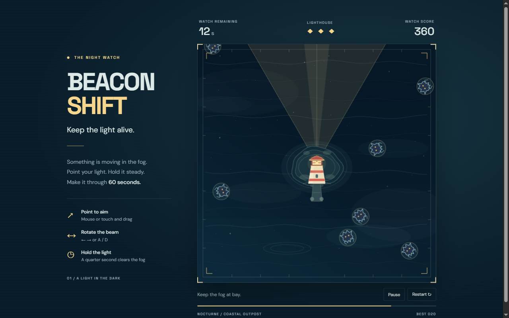

# Beacon Shift

**Keep the light alive.** Protect a lighthouse through a sixty-second night watch. Mist creatures approach from every direction; hold the light on them long enough to send them back into the fog.



Demo publication is pending. Run the production preview locally with the commands below.

[Source](https://github.com/matsaraiva/beacon-shift-phaser)

## Play

- Point the mouse or touch and drag inside the arena to aim.
- With the arena focused, hold **← / →** or **A / D** to rotate. The latest input method takes control.
- Keep a creature inside the 60° light cone for **0.25 seconds** to repel it and earn **10 points**. Leaving the cone resets its exposure.
- Protect three lives for **60 seconds**. A hit grants a visible half-second protection window.
- Use **Pause / Resume**, **P**, or **Escape** to pause. Leaving the window or hiding the tab pauses the run; resuming takes an intentional action.
- **Restart** begins a clean watch at any time. Scores may be saved on this device; blocked storage never prevents play.

No account, network service, audio, paid assets, or runtime AI is required.

## Run locally

Use Node.js 24 (minimum 22.12) and npm. Versions and the lockfile are pinned.

```sh
npm ci
npm run dev
npm test
npm run build
npm run preview -- --port 4174
```

The production preview is served at `http://127.0.0.1:4174/beacon-shift-phaser/`. Stop a running Vite server before `npm ci` on Windows, where its native binding can be locked by the server process.

## Architecture

| Module | Responsibility |
| --- | --- |
| `src/rules.ts` | Deterministic state, continuous exposure, arrivals, damage, score, spawn cadence and end states |
| `src/GameScene.ts` | Phaser 4 scene, procedural sea/lighthouse/creatures and bounded visual effects |
| `src/main.ts` | Fixed-step integration, native pointer/keyboard mapping, focus lifecycle and DOM HUD |
| `src/style.css` | Local fonts, responsive player interface and visible focus styles |

The renderer reads the simulation; it does not decide gameplay. Angular differences use `atan2(sin(delta), cos(delta))`, including the -π/π boundary. Pointer positions use the rendered canvas bounds to map to a stable 600×600 arena. Radial movement and cone checks need no physics engine.

Each simulation step expires protection, moves creatures, resolves exposure, resolves arrivals by stable identifier, then resolves loss before survival. Completing exposure and arriving in the same step repels the creature. A lethal hit on the final survival step loses the run. Spawn checks follow end-state checks, so results never spawn new enemies. Spawn intervals ramp from 1.5 to 0.65 seconds, with 12 active creatures maximum.

Gameplay uses seconds and 1/60-second integration steps. Long frame input is capped at 0.1 seconds. Pause stops simulation, clears held controls and discards stale timing on resume. Restarts reuse one scene and six Graphics objects; temporary effect records are capped at 36. Reduced motion removes ambient drift, creature bobbing and expanding event effects.

## Verification and evidence

See [QA.md](QA.md) for reproducible browser checks, results, screenshots, captured gameplay and limitations. Browser scripts observe a read-only snapshot enabled by `?qa=1`; gameplay actions still use real buttons, pointer, keyboard and emulated touch. The normal survival run uses real time without editing state or the clock.

Production builds currently emit a Vite size advisory for Phaser's approximately 364 kB gzipped runtime bundle. The game uses one scene, so splitting that engine would still require loading it before playing. Fonts are bundled locally.

## Publication and license

A manually triggered GitHub Pages workflow is in `.github/workflows/pages.yml`; ordinary pushes do not deploy. This project is licensed under [MIT](LICENSE), approved by the owner on 14 October 2026. Phaser and the bundled fonts retain their own dependency licenses.

## AI assistance

Developed for Matheus Saraiva Lima's browser-game portfolio with Codex assistance. GPT-6.1 coordinated implementation, integration, visual review and browser verification. Two native GPT-6 Luna xhigh workers implemented the deterministic rules/tests and Phaser scene, with a targeted integration review. Procedural art is source geometry; there are no AI-generated bitmap assets or runtime model calls.

## Technical references

- [Phaser official release archive](https://phaser.io/download/archive) and [official TypeScript/Vite template](https://github.com/phaserjs/template-vite-ts)
- [Phaser Graphics API](https://docs.phaser.io/api-documentation/class/gameobjects-graphics) and [Scale Manager](https://docs.phaser.io/api-documentation/class/scale-scalemanager)

The installed Phaser 4.2.1 package types are the exact API reference used for compilation; the hosted API reference displayed version 4.1.0 during implementation.
